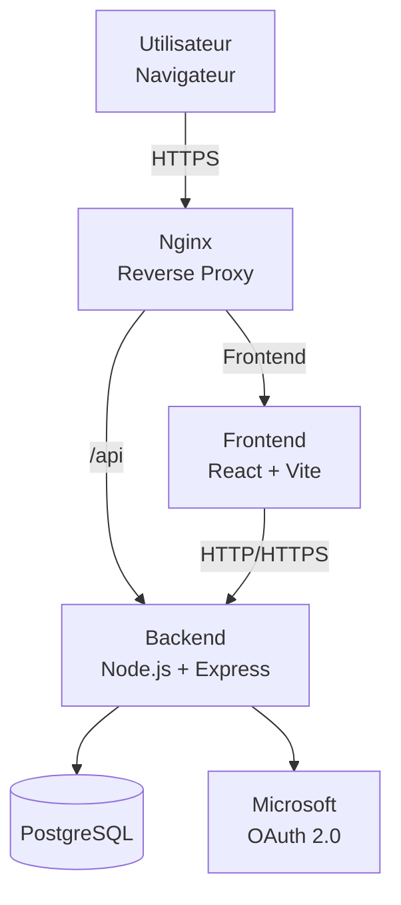
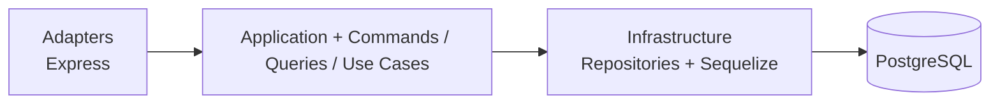
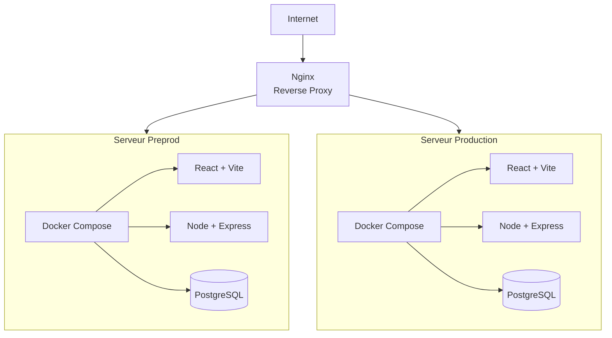

# Architecture du projet
Ce document présente l'architecture globale du projet ainsi que les raison des choix des différentes technologies.

## 1. Vue d'ensemble

L'application est construite autour d'une architecture web classique composée d'un frontend, d'un backend, d'une base de données et d'un reverse proxy.

Les principales technologies utilisées sont :

* **React + Vite** pour le frontend
* **Node.js + Express** pour le backend
* **PostgreSQL** pour la base de données
* **Sequelize** comme ORM
* **Nginx** comme reverse proxy
* **Docker** pour la conteneurisation
* **OAuth 2.0** pour l'authentification via Microsoft
* **GitHub Actions** pour la CI/CD
* **SonarQube** pour l'analyse de qualité du code

L'architecture backend suit une approche **hexagonale**, avec une séparation entre la logique métier, les cas d'utilisation et les éléments techniques externes.

### Shema vue d'ensemble


---

## 2. Architecture hexagonale

Le backend utilise une architecture hexagonale afin de séparer la logique métier des technologies utilisées pour communiquer avec l'extérieur.

L'objectif principal est de faire en sorte que les règles métier ne dépendent pas directement d'Express, de Sequelize ou de PostgreSQL.

L'application est organisée autour des **Use Cases**, eux-mêmes accessibles au travers de **Commands** et de **Queries**.

On distingue notamment :

* les **Controllers**, qui reçoivent les requêtes HTTP ;
* les **Commands**, utilisés pour les opérations qui modifient l'état de l'application ;
* les **Queries**, utilisées pour récupérer des informations ;
* les **Use Cases**, qui portent la logique applicative ;
* le **Domain**, qui contient les règles métier ;
* les **Repositories**, qui permettent à l'application d'accéder aux données sans dépendre directement de l'ORM ;
* l'**Infrastructure**, qui contient notamment l'implémentation des repositories avec Sequelize.

Cette organisation permet de limiter le couplage entre les différentes parties de l'application et facilite notamment les tests et l'évolution du projet.

### shema architecture hexagonale:


---

## 3. Frontend — React + Vite

Nous avons choisi **React** pour développer le frontend.

Le principal avantage recherché est son approche basée sur les **composants**. Les différentes parties de l'interface peuvent être développées, réutilisées et testées indépendamment.

Cette approche est particulièrement adaptée à notre application, qui possède plusieurs interfaces différentes selon le rôle de l'utilisateur : employé, manager et administrateur.

React offre également une grande flexibilité dans la manière d'organiser l'application et dans le choix des bibliothèques complémentaires. Nous pouvons ainsi sélectionner les outils nécessaires en fonction des besoins du projet sans être fortement contraints par un framework très opinionated.

### Pourquoi React plutôt qu'un framework frontend similaire ?

Des solutions comme Angular ou Vue auraient également permis de réaliser l'application.

Nous avons privilégié React principalement pour :

* notre familiarité avec son écosystème ;
* son système de composants ;
* sa flexibilité ;
* son écosystème important ;
* la facilité à réutiliser des composants entre les différentes interfaces de l'application.

Le choix de **Vite** permet quant à lui de disposer d'un environnement de développement et de build moderne et rapide, tout en restant simple à configurer.

---

## 4. Backend — Node.js + Express

Le backend est développé avec **Node.js et Express**.

Node.js permet de conserver un environnement JavaScript/TypeScript côté frontend et backend. Cela permet notamment à l'équipe de travailler avec un écosystème et des concepts communs sur l'ensemble de l'application.

Express a été choisi pour sa simplicité et son faible niveau de contrainte. Il permet de construire une API REST sans imposer une architecture trop rigide.

Un autre avantage important d'Express est son système de **middleware**. Celui-ci permet de centraliser facilement des fonctionnalités transverses telles que :

* l'authentification ;
* l'autorisation ;
* la validation des requêtes ;
* la gestion des erreurs ;
* les logs ;
* certains traitements liés aux requêtes HTTP.

Cela correspond bien aux besoins de notre application, qui comporte plusieurs routes protégées et plusieurs niveaux de droits.

### Pourquoi Express plutôt qu'une alternative ?

Des frameworks comme NestJS auraient pu être utilisés et proposent davantage de structure et de fonctionnalités intégrées.

Nous avons néanmoins privilégié Express car notre projet bénéficie déjà de sa propre organisation grâce à l'architecture hexagonale. Nous ne cherchons donc pas à faire porter au framework la responsabilité de structurer toute l'application.

Express nous permet ainsi de garder un framework HTTP simple tout en construisant nous-mêmes une architecture adaptée aux besoins du projet.

---

## 5. Validation des données — Zod

Nous utilisons **Zod** pour valider les données échangées par l'application.

Ses principaux avantages sont :

* la validation des données à l'exécution ;
* une bonne intégration avec TypeScript ;
* la génération des types TypeScript à partir des schémas ;
* la possibilité de partager les schémas entre le frontend et le backend ;
* la centralisation des contrats d'API.

Les schémas partagés concernent les **contrats d'API** et non les modèles Sequelize. Sequelize reste utilisé côté backend pour la persistance des données.

Zod et Sequelize sont donc complémentaires : **Zod valide les données échangées avec l'application, tandis que Sequelize gère l'accès à PostgreSQL**.


## 6. Base de données — PostgreSQL

Nous avons choisi **PostgreSQL** comme système de gestion de base de données relationnelle.

Ce choix repose principalement sur notre expérience avec cette technologie. L'équipe dispose déjà de connaissances sur PostgreSQL, ce qui permet de réduire le temps nécessaire à sa prise en main et de limiter les risques liés à l'utilisation d'une technologie inconnue.

PostgreSQL est également particulièrement adapté aux données de notre application, qui sont fortement relationnelles : utilisateurs, équipes, rôles, pointages, historiques et autres données associées.

Son modèle relationnel permet notamment de garantir l'intégrité des relations entre ces différentes données.

### Pourquoi PostgreSQL plutôt qu'une autre base relationnelle ?

Des solutions comme MySQL ou SQLite auraient également pu répondre aux besoins fonctionnels de l'application.

Nous avons cependant privilégié PostgreSQL pour plusieurs raisons :

l'expérience et les connaissances déjà présentes au sein de l'équipe ;
- ses fonctionnalités relationnelles ;
- sa maturité et sa robustesse ;
- sa bonne intégration avec l'écosystème Node.js ;
- son adéquation avec les données structurées de l'application ;
- ses possibilités d'évolution et de montée en charge.

Nous avons notamment écarté SQLite, malgré sa simplicité de mise en place et sa faible complexité opérationnelle,  il est moins adapté à notre objectif d'avoir une application pouvant évoluer vers une architecture avec plusieurs instances du backend et une charge plus importante.

---

## 7. ORM — Sequelize

Nous avons choisi **Sequelize** pour gérer l'accès à PostgreSQL depuis le backend.

L'ORM permet d'éviter de gérer directement l'ensemble des requêtes SQL dans le code applicatif et facilite notamment la définition des modèles, des relations et des opérations CRUD.

Le principal critère de choix a été sa **simplicité d'utilisation**. L'équipe souhaitait utiliser un ORM suffisamment complet tout en restant simple à prendre en main et à intégrer à notre architecture.

### Pourquoi Sequelize plutôt que Prisma ?

Prisma a été étudié comme alternative mais a été rejeté car plusieurs membres de l'équipe ont eu une expérience négative de son utilisation auparavant. Nous avons choisi de privilégier une solution que nous jugeons plus simple et plus adaptée à notre manière de travailler.

Sequelize permet également de conserver une séparation claire entre les Use Cases et l'accès aux données : les Use Cases utilisent des repositories, tandis que Sequelize reste dans la couche infrastructure.

Le choix de Sequelize est donc autant un choix technique qu'un choix pragmatique permettant de limiter les risques et de faciliter le développement par l'équipe.

---

## 8. Reverse proxy — Nginx

**Nginx** est utilisé comme reverse proxy devant l'application.

Son rôle est de recevoir les requêtes des clients et de les transmettre vers les services appropriés.

Il permet notamment de séparer l'accès public à l'application des services internes et peut être utilisé pour router les requêtes vers le frontend ou l'API backend.

Nginx est également capable de gérer des problématiques telles que HTTPS, les headers HTTP, la compression ou encore la répartition des requêtes entre plusieurs instances.

Nous avons retenu Nginx car il est mature, largement utilisé et suffisamment simple pour les besoins de notre application.

Une solution plus complexe n'apporterait pas de bénéfice significatif à ce stade du projet.

---

## 9. Docker

Docker est utilisé pour conteneuriser l'application, son utilisation étant imposée par les contraintes du projet.

Chaque service dispose de son propre Dockerfile, permettant de définir indépendamment son environnement, ses dépendances et son mode de démarrage. Les services sont ainsi isolés les uns des autres et peuvent évoluer ou être déployés indépendamment.

Un fichier Docker Compose permet d'orchestrer l'ensemble des conteneurs et de lancer l'application complète avec une seule commande :

```docker compose up```

Cette organisation permet notamment de séparer les différents composants de l'application tout en conservant une configuration centralisée pour leur exécution et leur communication.

### diagramme deploiement


---

## 10. CI/CD et qualité du code

Le projet utilise **GitHub Actions** pour automatiser les contrôles réalisés lors des Pull Requests et les étapes de déploiement.

**SonarQube** est utilisé en complément afin d'analyser la qualité du code et de détecter notamment les problèmes potentiels de maintenabilité ou de qualité.

Cette automatisation permet de détecter les régressions et problèmes de qualité avant l'intégration du code dans les branches principales.

---

## 11. Schémas de BDD

Le shéma de BDD est défini dans documentation\schema.dbml

---

## bucket images

Nous avons choisi **Amazon S3** pour stocker les images de profil et les futurs fichiers de l'application. L'équipe connaît déjà cette technologie, ce qui facilite son intégration. De plus, cette technologie pourra etre adaptée aux besoins futurs du projet si nécessaire.

## 12. Résumé

| Élément                  | Technologie           | Raisons principales                                             |
| ------------------------ | --------------------- | --------------------------------------------------------------- |
| Frontend                 | React + Vite          | Composants, flexibilité, écosystème                             |
| Backend                  | Node.js + Express     | Simplicité, écosystème commun, middleware                       |
| Architecture             | Hexagonale            | Séparation des responsabilités, testabilité, maintenabilité     |
| Base de données          | PostgreSQL            | Expérience de l'équipe, modèle relationnel, maturité            |
| ORM                      | Sequelize             | Simplicité, expérience de l'équipe, intégration avec PostgreSQL |
| Reverse proxy            | Nginx                 | Maturité, simplicité, routage et évolutivité                    |
| Conteneurisation         | Docker                | Technologie imposée par le projet                               |
| CI/CD                    | GitHub Actions        | Automatisation des tests et du déploiement                      |
| Qualité                  | SonarQube             | Analyse automatisée de la qualité du code                       |
| Authentification externe | OAuth 2.0 / Microsoft | Authentification via le compte Microsoft                        |
| Stockage de fichiers     | Amazon S3             | Stockage objet évolutif, expérience de l'équipe et contrôle des accès |